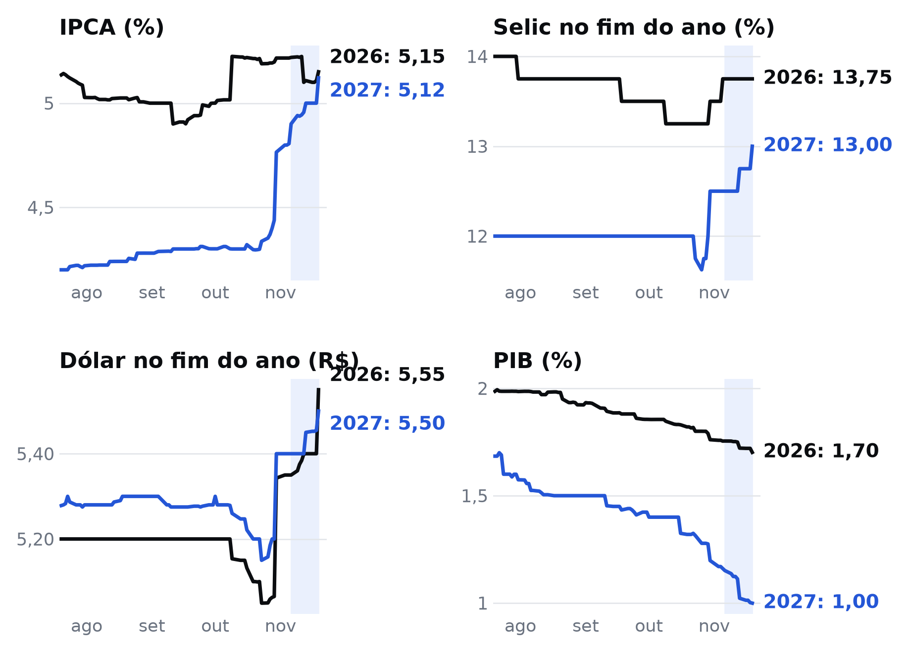

# Legacy Research

Laboratório independente de pesquisa macroeconômica: Brasil e mundo, com dados e métodos abertos.

**Site:** [legacyresearch.github.io](https://legacyresearch.github.io) · **Painel do Focus:** [legacyresearch.github.io/#focus](https://legacyresearch.github.io/#focus) · **LinkedIn:** [Legacy Research](https://www.linkedin.com/company/legacyresearch/)



## Painel do Boletim Focus

Toda segunda-feira, um código em Python busca as projeções do [Boletim Focus](https://www.bcb.gov.br/publicacoes/focus) na API do Banco Central, guarda o histórico e gera os gráficos de **IPCA, Selic, câmbio e PIB**. O site lê esses arquivos e se atualiza sozinho.

| Arquivo | O que faz |
|---|---|
| `focus.py` | Busca as medianas na API do Banco Central (Olinda), salva o histórico e gera os gráficos do site |
| `focus_mobile.py` | Gera a versão para posts (fundo branco, letra grande) e a comparação de duas semanas |
| `.github/workflows/atualizar-focus.yml` | Roda os dois scripts toda segunda, ao meio-dia de Brasília |
| `dados/focus.csv` | Histórico das medianas diárias: indicador, data, ano de referência e mediana |
| `dados/focus_comparacao.csv` | Valores de agora e de duas semanas atrás, por indicador e ano |
| `dados/analises.json` | Textos da "Leitura da semana" que aparecem no painel |
| `graficos/` | Gráficos gerados (`*_focus.png`, `painel_focus.png` e `focus_post.png`) |
| `expectativas/` | Arquivo das "Expectativas da semana" |

### Como rodar no seu computador

```bash
pip install -r requirements.txt
python focus.py
python focus_mobile.py
```

### Metodologia

- Os valores são as **medianas diárias** das projeções do mercado publicadas pelo Banco Central.
- O relatório de segunda usa os dados até a sexta anterior. Por isso, a comparação de duas semanas usa o último dia com dado antes de cada relatório.
- As escalas dos gráficos têm um tamanho mínimo, para que mudanças pequenas não pareçam enormes.

## Aviso

Conteúdo educacional. A Legacy Research não faz recomendação de investimento. A Legacy usa ferramentas de IA, incluindo o Claude, da Anthropic, para apoiar a pesquisa e o código. A análise e as opiniões são do time.
